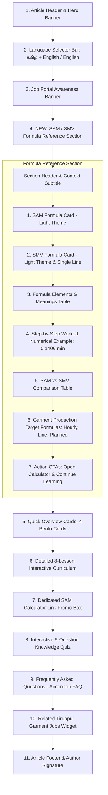

# Implementation Plan: SAM/SMV Educational Blog Enhancement — DigiGarment

## 1. Project Overview & Objective
* **Target Educational Blog URL:** [https://tirupurgarment.in/blog/what-is-sam-in-garment-manufacturing](https://tirupurgarment.in/blog/what-is-sam-in-garment-manufacturing)
* **Local Test URL:** [http://127.0.0.1:8000/blog/what-is-sam-in-garment-manufacturing](http://127.0.0.1:8000/blog/what-is-sam-in-garment-manufacturing)
* **Dedicated Calculator URL:** [https://tirupurgarment.in/tools/sam-calculator](https://tirupurgarment.in/tools/sam-calculator) (`/tools/sam-calculator`)
* **Objective:** Transform the existing SAM blog page into an authoritative, high-ranking, and practical educational resource for apparel manufacturing and industrial engineering (IE) professionals across Tiruppur and global garment export hubs.
* **User Learning Journey:**
  $$\text{Understand Core Formula} \longrightarrow \text{Learn Every Element} \longrightarrow \text{Follow Worked Example} \longrightarrow \text{Use SAM Calculator} \longrightarrow \text{Explore 8 Detailed Lessons \& Quiz}$$

---

## 2. Strict Scope Boundaries
To guarantee absolute stability across production and avoid regression:
1. **Primary Target File:** `sam_blog_post.html` and router serving logic in `routers/seo.py`.
2. **Untouched Areas:**
   - Homepage (`index.html`) & Jobs Portal (`jobs.html`).
   - Unrelated blog posts.
   - Dedicated calculator UI and core calculation algorithms (`sam_calculator.html`).
   - Global navigation headers, auth routers, and job ingestion database pipelines.
3. **No Deploy Actions:** Changes remain local until approved.

---

## 3. Architecture & Page Section Structure
The article follows a strict vertical order to prioritize immediate high-intent answers while retaining in-depth pedagogy:

---

## 4. Bilingual Architecture & Engine

### Language Engine Mechanics
* Dynamic in-browser client-side rendering via `setLanguage(lang)` function.
* `localStorage.getItem("sam_blog_lang")` persists user selection across visits.
* **No full-page reload** ensures that interactive quiz state, scroll position, and tab selections are preserved.

### Language Modes & Tone Standards
1. **தமிழ் + English Mode (`ta`):**
   * Written in **formal Tamil script** with natural English technical loanwords (*SAM, Machine Sewing Time, Basic Cycle Time, Allowance, SPI, RPM, Line Efficiency*).
   * **Strict Rule:** Absolutely no English transliteration of Tamil sentences (no Romanized Tanglish).
   * *Example:*
     > "SAM என்பது ஒரு garment operation-ஐ complete செய்வதற்குத் தேவையான standard time-ஐ minutes-ல் குறிக்கிறது. Machine Sewing Time, Handling Time மற்றும் applicable Allowance ஆகியவற்றைப் பயன்படுத்தி SAM calculate செய்யலாம்."
2. **English Mode (`en`):**
   * Clear, formal industrial engineering terminology.
   * *Example:*
     > "SAM represents the standard time allocated to complete a garment operation, expressed in minutes. Depending on the approved time-study method, it may include machine sewing time, handling time, and applicable allowances."

---

## 5. Detailed Formula Specifications

### A. SAM Formula Card (Standard Allowed Minutes)
* **Badge:** `📐 CORE APPAREL FORMULA`
* **Card Styling:** Soft Light Blue gradient (`linear-gradient(135deg, #F0F7FF 0%, #E0F2FE 100%)`), `border: 1.5px solid #93C5FD`, `box-shadow: 0 4px 14px rgba(37, 99, 235, 0.08)`.
* **Primary Formula:**
  $$\mathbf{SAM\ (minutes)} = \frac{\left[\mathbf{Basic\ Cycle\ Time\ (seconds)} \times \left(1 + \frac{\mathbf{Total\ Allowance\ \%}}{100}\right)\right]}{60}$$
* **Component Breakdown:**
  $$\mathbf{Basic\ Cycle\ Time\ (seconds)} = \mathbf{Machine\ Sewing\ Time} + \mathbf{Handling\ and\ Positioning\ Time}$$

### B. SMV Formula Card (Standard Minute Value)
* **Badge:** `🌐 INTERNATIONAL GSD FORMULA`
* **Card Styling:** Soft Light Rose gradient (`linear-gradient(135deg, #FFF1F2 0%, #FFE4E6 100%)`), `border: 1.5px solid #FECDD3`, `box-shadow: 0 4px 14px rgba(225, 29, 72, 0.08)`.
* **Layout Geometry:** Identical centered alignment matching SAM card width.
* **Primary Formula (Strict Single-Line Format):**
  $$\mathbf{SMV\ (minutes)} = \frac{\mathbf{Standard\ Operation\ Time\ (seconds)}}{60}$$
* **Allowance-Adjusted Variation:**
  $$\mathbf{SMV} = \frac{\left[\mathbf{Basic\ Cycle\ Time\ (sec)} \times \left(1 + \frac{\mathbf{Total\ Allowance\ \%}}{100}\right)\right]}{60}$$

---

## 6. Formula Elements & Variables Table
Responsive data table detailing all variables used in apparel work-study:

| Formula Element | Technical Meaning | Unit | Real Garment Example |
| :--- | :--- | :--- | :--- |
| **Machine Sewing Time** | Time required for sewing machine needle to stitch fabric seam. | Seconds | 4-thread overlock seam on collar rib (2.4s) |
| **Total Stitch Count** | Total needle stitches calculated as: $\text{Seam Length (in)} \times \text{SPI}$. | Stitches | 10 in seam $\times$ 12 SPI = 120 stitches |
| **Effective Machine Speed** | Practical operating stitching speed accounting for acceleration and curves. | RPM / SPM | Rated 5,000 RPM running at 3,000 effective SPM |
| **Handling & Positioning** | Time spent picking up, matching notches, and aligning garment panels. | Seconds | Picking fabric panels, positioning, disposal (5.0s) |
| **Basic Cycle Time** | Machine Sewing Time + Handling and Positioning Time. | Seconds | 2.4s sewing + 5.0s handling = 7.4 seconds |
| **Total Allowance %** | Extra time allocated for Personal needs (5-7%), Fatigue (3-5%), and Delays. | % | Standard relaxation allowance of 14% |
| **Allowance Multiplier** | Multiplier factor calculated as: $1 + (\text{Total Allowance \%} / 100)$. | Factor | $1 + (14 / 100) = 1.14$ multiplier |
| **Seconds-to-Minutes** | Dividing total seconds by 60 to obtain standard decimal minutes. | Factor | 8.436 seconds $\div$ 60 = 0.1406 minutes |

---

## 7. Step-by-Step Worked Numerical Example
* **Sample Operation:** 4-Thread Overlock Seam on T-Shirt Collar Rib.
* **Input Parameters:**
  * Seam Length = **10 inches**
  * Stitch Density = **12 SPI**
  * Effective Machine Speed = **3,000 stitches/min**
  * Handling & Positioning Time = **5.0 seconds**
  * Total Allowance = **14%** (Personal: 5%, Fatigue: 5%, Delay: 4%)

* **Step-by-Step Calculation Engine:**
  1. $\text{Total Stitches} = 10\text{ inches} \times 12\text{ SPI} = \mathbf{120\text{ stitches}}$
  2. $\text{Machine Sewing Time} = \left(\frac{120}{3,000}\right) \times 60 = \mathbf{2.4\text{ seconds}}$
  3. $\text{Basic Cycle Time} = 2.4\text{s} + 5.0\text{s} = \mathbf{7.4\text{ seconds}}$
  4. $\text{Allowance Multiplier} = 1 + \left(\frac{14}{100}\right) = \mathbf{1.14}$
  5. $\text{Standard Allowed Time (Seconds)} = 7.4 \times 1.14 = \mathbf{8.436\text{ seconds}}$
  6. $\mathbf{Final\ SAM} = \frac{8.436}{60} \approx \mathbf{0.1406\text{ minutes}}$

* **Highlight Result Callout:**
  > **SAM ≈ 0.141 minutes per operation** *(8.44 seconds per piece)*

---

## 8. Garment Production Target Equations

### Equation A: Single-Operation Hourly Target
Theoretical hourly quota for an operator dedicated to one workstation:
$$\text{Hourly Target (Pieces / Hr)} = \frac{60}{\text{Operation SAM}}$$
*Example:* $\frac{60}{0.141} \approx 425\text{ pieces/hour}$ *(100% efficiency)*.

### Equation B: Theoretical Sewing Line Target
Overall hourly output of a balanced production line:
$$\text{Theoretical Line Target (Pieces / Hr)} = \frac{\text{Total Number of Line Operators} \times 60}{\text{Total Garment Style SAM}}$$
*Example:* 40 operators on a Round Neck T-shirt (Style SAM = 4.8 min):
$$\frac{40 \times 60}{4.8} = \mathbf{500\text{ pieces/hour}}$$

### Equation C: Planned Line Target (Efficiency-Adjusted)
Realistic factory floor quota calibrated to the line's expected efficiency:
$$\text{Planned Line Target} = \text{Theoretical Line Target} \times \left(\frac{\text{Target Efficiency \%}}{100}\right)$$
*Example:* At 75% target efficiency: $500 \times 0.75 = \mathbf{375\text{ pieces/hour}}$.

---

## 9. SAM vs SMV Comparative Matrix

| Comparative Metric | SAM (Standard Allowed Minutes) | SMV (Standard Minute Value) |
| :--- | :--- | :--- |
| **Full Form** | Standard Allowed Minutes | Standard Minute Value |
| **Measurement Unit** | Decimal Minutes | Decimal Minutes |
| **Origin & Tradition** | US / Asian Apparel IE Engineering | British Work-Study & GSD Systems |
| **Factory Usage** | Line balancing, shopfloor operator efficiency | Tech packs, European buyer cost sheets |
| **Equivalence** | **1.0 SAM = 1.0 SMV** under identical rating and allowance standards. |

---

## 10. Calculator Integration & Action CTAs
Positioned immediately after Equation C:
1. **Primary Tool CTA Button:**
   * Text: `Calculate SAM / SMV Now →`
   * Link: `/tools/sam-calculator`
   * Styling: High-contrast Digigarment Red (`#9E1B32`), bold typography.
2. **Continue Learning Anchor CTA:**
   * Text: `Continue to Detailed SAM / SMV Lessons ↓`
   * Link: `#curriculumSection`
   * Smooth scroll action triggering curriculum tabs.

---

## 11. Responsive Viewport Testing Plan

| Viewport | Device Class | Critical Validation Point |
| :--- | :--- | :--- |
| **1440px / 1280px** | Desktop Displays | Formula cards centered with matching lengths; no horizontal stretch. |
| **1024px** | Laptop / iPad Pro | Formulas stay strictly single-line; padding balances cleanly. |
| **768px** | Tablets / Foldables | Tables enable horizontal scroll without page-wide overflow. |
| **390px / 360px** | Mobile Smartphones | Inline tags adapt cleanly; font size scales responsively. |

---

## 12. Verification Checklist & Current Status

* [x] **Light Color Fills Implemented:** SAM box uses soft blue (`#F0F7FF`), SMV box uses soft rose (`#FFF1F2`).
* [x] **Inline Font Rendering Fixed:** `<small>` tag display block bug resolved by converting to inline ``.
* [x] **Single-Line Formula Integrity:** `white-space: nowrap` ensures `(seconds) ÷ 60` never wraps.
* [x] **Original SAM Alignment Restored:** Reverted unintentional full-width stretching; original compact layout preserved.
* [x] **Bilingual Switching Verified:** Tamil script + English technical terms function without page reload.
* [x] **Git Repository Synced:** Committed and pushed to `origin/main` (`e5dc1c2`).
